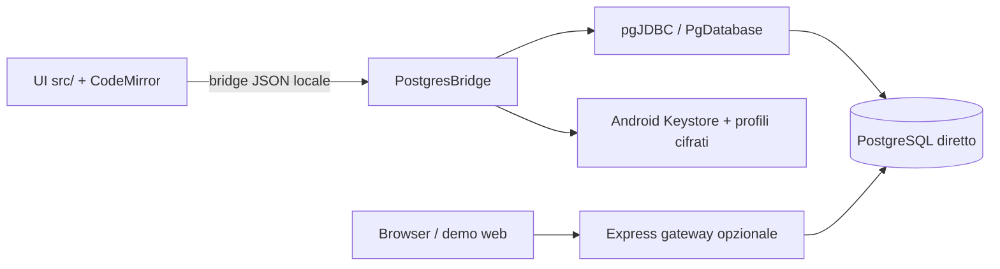

# Architettura — Psql Mobile

## Componenti

- Frontend ES modules in `src/`, compilato con Vite 6; HTML/CSS in root e `src/`; CodeMirror fornisce editor SQL.
- Android Java 17 in `android/app`: `MainActivity` ospita WebView locale; `WebViewAssetLoader` serve asset APK; `PostgresBridge` riceve richieste UI e invia risposte asincrone; `PgDatabase`, `RecordService`, `RelationCatalog` e `InverseRelations` implementano accesso PostgreSQL, metadati e operazioni record.
- pgJDBC 42.7, AndroidX Core/WebKit. Profili, preferiti e certificati persistiti in storage privato Android cifrato via AES-256-GCM e chiave non esportabile Android Keystore (`ConnectionStore`, `FavoritesStore`). Le sessioni DB attive restano in memoria.
- `server/` è un gateway Express 5 con `pg` per la versione browser precedente; non è richiesto dall’APK.

Nel flavor `android`, Vite aggiunge una CSP con `connect-src 'none'`, rimuove il manifest web e produce `dist-android`, incluso negli asset dell’app. Non esiste endpoint HTTP locale per le query; il bridge è il trasporto. Nel browser senza Android le API/demo usano il gateway per connessioni reali o dati fittizi.

## Flusso dati e limiti

La UI costruisce la richiesta e la invia con ID sequenziale al bridge. Java opera su worker, apre connessione JDBC diretta al PostgreSQL dell’utente e restituisce valori come testo per mantenere precisione. I risultati hanno limiti di righe, celle, caratteri e schema. Le modifiche richiedono provenienza tabellare non ambigua e PK completa; lookup e relazioni usano query parametrizzate. I permessi PostgreSQL e RLS restano applicati.

TLS usa `verify-full` come default; le modalità esplicite modificano il livello di verifica. CA e certificati client importati sono associati alla connessione; chiave privata client via PKCS#12. Timeout connessione/query/socket e chiusura sessione inattiva sono implementati in `PgDatabase`/opzioni.

## Build e distribuzione

`npm run build:android` crea gli asset Android; Gradle assembla APK. `npm run build` produce il sito browser. Workflow CI esegue test frontend, build, unit/instrumentation Android e controlli dell’APK; Pages pubblica sito e APK già firmato, non contiene la chiave privata. La configurazione di firma è esterna via `PSQL_SIGNING_PROPERTIES` o percorso locale documentato nel README.

Trade-off: WebView riusa UI e regole frontend, mantenendo database e credenziali nella parte nativa; connessione diretta evita backend ma richiede che il database sia raggiungibile dal telefono. Il gateway web conserva compatibilità ma aggiunge un servizio con token statico da proteggere.
